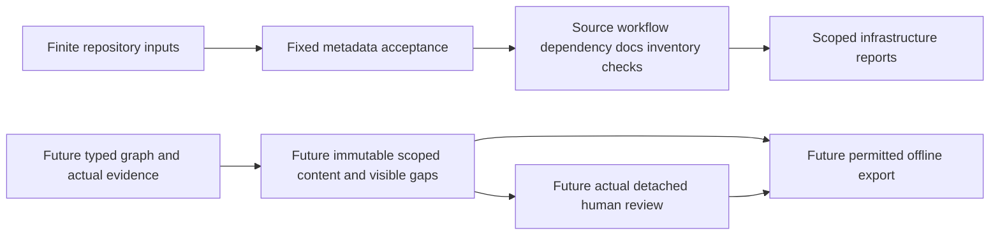

<!--
SPDX-License-Identifier: AGPL-3.0-or-later
Commercial license available
© Concepts 1996–2026 Miroslav Šotek. All rights reserved.
© Code 2020–2026 Miroslav Šotek. All rights reserved.
ORCID: 0009-0009-3560-0851
Contact: www.anulum.li | protoscience@anulum.li
NEURO-SAFETY-CASE — repository governance and provenance
-->

# Architecture

The implemented surface is local repository validation tooling under tools/assurance_validation. Fixed scripts validate metadata, maintained source and licence provenance, workflow policy, development dependencies, rendered documentation and deterministic inventory. Reports cover the named infrastructure operation only.

An independent closed metadata schema binds repository identity, governance profile, interpreter and exact raw development lock. Accepted metadata precedes exclusive complete output generation; read-only verification never repairs an inventory.

The planned Python composition library separates typed arguments, actual evidence binding, complete declared claim coverage, limits, detached human review and export. Structural completeness is a derived graph property. It is not a human judgment of relevance, sufficiency or safety.

Common representation, custody and current trust stay with EVIDENCE-MANIFEST-TOOLKIT; source instruments retain evidence ownership, Ledger retains lineage, and human assessors retain judgment. Studio will display the same gaps and limitations. These are planned integrations, not installed dependencies.

Read the [component guide](docs/ARCHITECTURE.md), [trust boundaries](docs/THREAT_MODEL.md) and [validation commands](VALIDATION.md).
